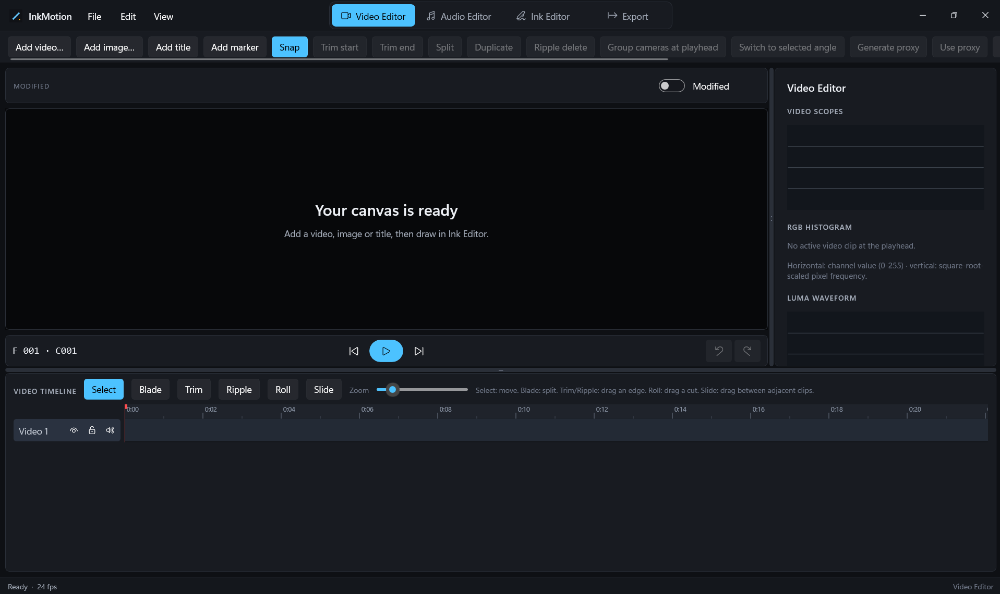
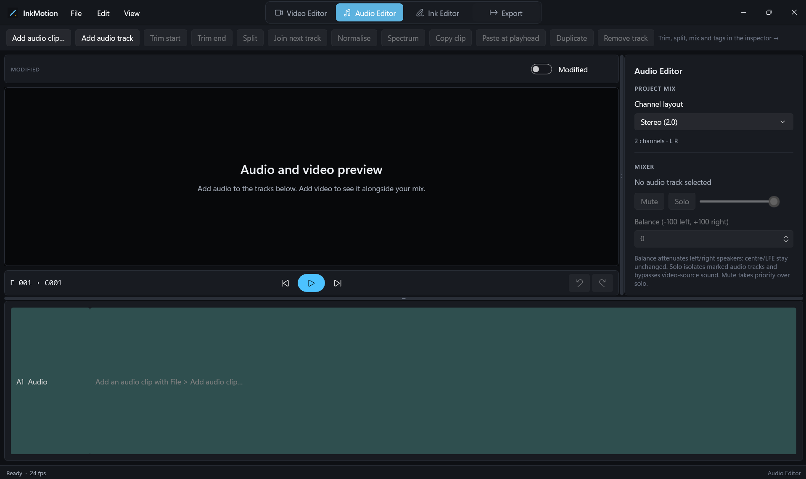
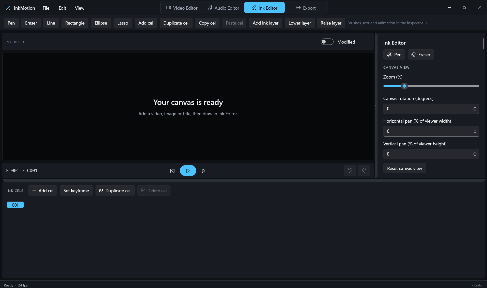
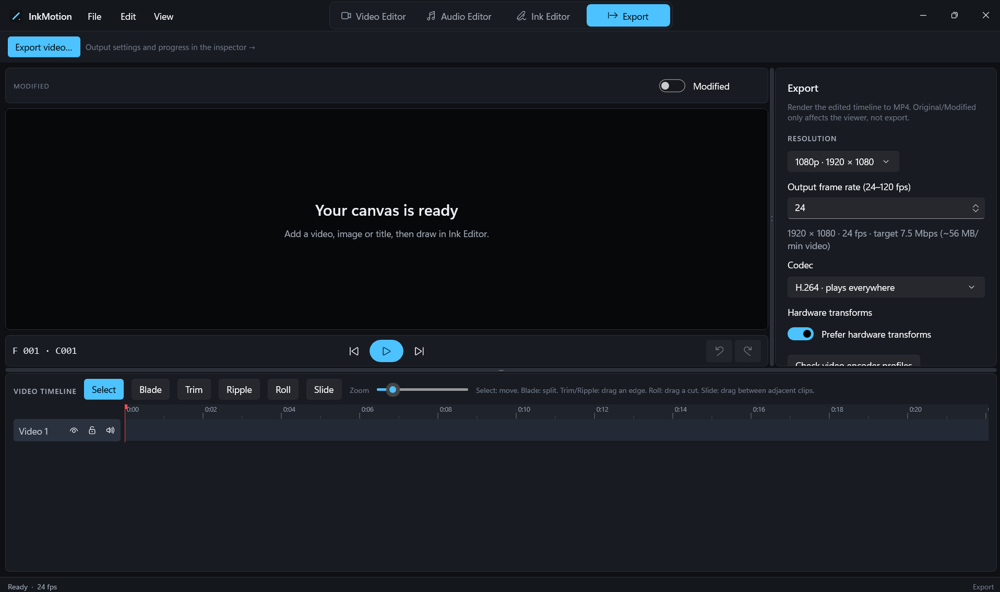

# InkMotion

InkMotion is a native Windows video editor in early development, built with C#, .NET 10, WinUI 3, and the Windows App SDK.

## First milestone

- Switch between four pages with the **Video Editor**, **Audio Editor**, **Ink Editor**, and **Export** buttons at the top of the window. A responsive ribbon-style command bar provides page-specific actions and moves lower-priority commands into its overflow menu as the window narrows, instead of requiring a horizontal scrollbar. All four pages share the video/audio viewer on the left, a page-specific inspector on the right, and a timeline across the bottom, with a shared transport bar (frame readout, previous/play/next, undo/redo) under the preview.
- Use **Original / Modified** above the viewer to compare the active video source at the playhead with the edited timeline. Original bypasses video opacity, clip volume/mute, image/title/ink overlays and added audio; it keeps the timeline's source-in mapping to compare the same source frame. Switching pauses playback and never changes the project or export. Original is not a second timeline of the entire unedited project; it is blank where no visible video clip is active. Modified shows ink on every page, with drawing input and optional onion-skin guides restricted to Ink Editor.
- Use the **File** menu in the title bar to open (Ctrl+O) and save (Ctrl+S) projects, add video, image, title, and audio clips, and go to the Export page; the **Edit** menu provides undo and redo.
- Build native x86 and x64 Windows targets, and create an x86/x64 MSIX upload bundle for the Microsoft Store with the Partner Centre identity supplied from repository secrets.
- Use the Video Editor for video preview and playback, the Audio Editor for multitrack clip placement, waveform previews, mixing, and tag editing, and the Ink Editor for pen-first drawing and cel animation.
- Image overlays support saved **Image rotation** from -180 to 180 degrees clockwise about their X/Y centre, combined with existing aspect-fit and scale. Preview and export share the same rendering; pixels outside the canvas are clipped. Rotation supports undo/redo, splitting/copying and track locks. Existing projects migrate with neutral rotation. This is static image rotation, not video/title rotation, crop or transform keyframes.
- In the Ink Editor, **Sample drawing colour...** samples a clicked pixel from visible ink layers and cel text, including opacity; **Sample drawing at X/Y** provides percentage-based keyboard access. It uses the shared drawing compositor and samples locked layers without modifying drawings or project history. Transparent pixels retain the current brush colour. Sampling is one-shot and returns to the pen; video, images, timeline titles, backgrounds, onion-skin guides and selection outlines are excluded.
- **Sample full preview colour...** samples the Modified preview instead: visible video/image layers with their effects, crop, animated transforms and transitions, timeline titles, ink and the canvas background. **Sample full preview at X/Y** uses the same percentage coordinates for keyboard access, including when the canvas is zoomed or rotated. Onion skin, guides, selection outlines and empty-state labels are excluded. Unavailable media reports an error without changing the brush; images still loading must finish before sampling. Original preview must be switched to Modified explicitly. Neither sampler edits media, drawings or project history.
- Add typed text overlays centred in animation cels, with selectable font family, size, and brush colour, separate from pressure-sensitive freehand ink.
- Select an overlay under **Existing text on this cel**, or choose **Select text on canvas...** and click its rendered text bounds in Modified preview. The topmost visible cel-text overlay wins; transparent text, timeline titles, strokes and onion guides are excluded. A preview-only outline identifies the selected overlay. Edit its text, font, size, X/Y position and independent alpha colour, then choose **Apply to selected text**. **Remove selected text** deletes only that overlay; both actions support undo/redo and save/load. Switching cels or overlays discards unapplied selected-overlay edits. Existing **Add text to cel** still creates a centred overlay using the brush colour, and **Remove last text** retains its original behaviour. Text is cel-wide rather than owned by drawing layers, so drawing-layer locks do not block these operations. Canvas selection is one-shot and selects whole overlays; character editing uses the inspector text box, not on-canvas caret placement or character-range styling.
- On the Export page, select 720p, 1080p, 1440p, or 4K UHD independently of the output frame rate (24-120 fps, including decimal rates). Ink exposure timing follows project time rather than the output frame count, so a higher output rate does not speed up the drawings.
- Choose software video encoding or prefer hardware transforms, with a reported software fallback. The video quality/file-size slider changes the target bit rate, with an approximate video-only MB/min estimate; actual size depends on content and the encoder. H.264/HEVC availability and supported high-rate/resolution combinations depend on Windows codecs and hardware. **Check video encoder profiles** performs one-frame software encode/finalise probes at 720p through 4K UHD and common 24-120 fps integer/fractional rates; **Measure selected profile** runs a two-second synthetic encode. These are local capability/performance samples, not sustained device certification or confirmation that a hardware encoder was used.
- Export a separate audio mix as PCM WAV (16/24/32-bit integer), 32-bit float WAV, MP3 or AAC/M4A. WAV rates are 44.1, 48, 88.2, 96, 176.4, 192, 352.8 and 384 kHz; the mixer runs at the selected rate and resamples sources only when needed. Increasing the rate does not restore detail absent from a source. WAV preserves the project channel layout and uses dither for integer quantisation; files beyond the 4 GB RIFF limit are rejected. MP3 and AAC use Windows encoders at 44.1/48 kHz and 128/160/192/256/320 kbps, with stereo downmix for surround projects. **Check installed audio encoders** lists reported mono/stereo format combinations on this PC. Separate lossy exports select an exact matching native output type, never a nearest-bit-rate substitution; unavailable combinations report errors before touching the output. Actual compressed size/average bit rate still depends on encoder behaviour and content. MP4 has independent AAC controls for 44.1/48 kHz and 128/160/192 kbps; its sink-writer compatibility is checked at export rather than inferred from separate-file discovery. Lossy AAC has no selectable PCM bit depth.
- Video and audio exports run in independent, windowless `InkMotion.exe` worker processes, not editor threads. Closing or crashing the editor does not cancel a running worker. The editor automatically scans saved jobs at startup and monitors them in **Export → Export jobs**, with progress, warnings, failures and cancellation available after reopening. Immutable project snapshots, settings and atomic status records are kept locally under `%LOCALAPPDATA%\InkMotion\ExportJobs`; source media is linked, not copied, so keep those files available and unchanged while exporting. This job history is retained locally, including file paths and snapshot content.
- Worker leases prevent duplicate execution and avoid confusing reused process identifiers with active exports. A worker crash, Windows shutdown/restart or external termination is reported as **Interrupted**, not successful; partial output may remain in that case. **Retry saved job** restarts a failed, cancelled or interrupted job from its original snapshot and settings at the same output path (replacing that output); it does not resume mid-file or export the current editor state. Cancellation asks the worker to stop and clean up its own partial output. Active jobs reserve output/stem paths against conflicting submissions. The editor waits for active jobs before enabling a new submission; this is not yet a scheduled render queue.
- Export the timeline to an MP4 file with H.264 or HEVC video at 720p, 1080p, 1440p, or 4K UHD and the selected output frame rate. Every visible video, image, and title track is composited in timeline order on the GPU with Win2D, ink drawings and typed overlays are drawn on top at their exposures, and frames are encoded through Windows Media Foundation. GPU encoding is a hardware preference with software fallback; switching it off selects software encoding (Win2D composition still uses the GPU). Audio tracks (with tempo, pitch, fades, gain and effects) and unmuted video-clip audio are mixed at the selected AAC rate (stereo, or up to 5.1 for surround layouts); if Windows cannot encode 5.1 AAC, the MP4 falls back to stereo. Whenever the MP4 carries fewer channels than a surround mix, the full mix is also written to a 24-bit multichannel WAV at the selected rate beside the video. Export shows progress, can be cancelled, and removes partial files. HEVC requires the HEVC Video Extensions.
- Use multitrack video compositing in both the modified preview and export. Video, images and titles render in timeline order, including simultaneously visible video layers and both sides of a cross-dissolve; ink drawings and typed overlays are composited over them at their exposure timing.
- Create a multicamera group from overlapping video tracks, switch the active angle at the playhead, and keep the selection through clip splits. Groups and switches save with the project and support undo/redo. Angle membership follows track identity; groups cannot be created during a cross-dissolve.
- Generate local 24 fps H.264 proxy media scaled to a maximum 960-pixel dimension. Select original or proxy per clip for preview and export; embedded audio remains sourced from the original. Missing or stale proxies fall back to the original and are reported during export. Proxy files are kept in the local InkMotion cache and are not automatically deleted.
- Build a multitrack video timeline with video, image (PNG, JPEG, BMP, GIF, TIFF, or WebP), and title tracks. Add clips at the playhead, drag them in time or onto another track of the same kind, and trim the start or end, split, move to the playhead, delete, or ripple delete. Tracks can be added, renamed, reordered, hidden, locked, and (for video) muted; clip opacity, fades, volume, still duration, position, scale, and title font, size, and colour are editable, all with undo/redo.
- Toggle timeline snapping to align dragged clip starts or ends to other clip edges, audio edges, markers, the playhead or timeline start within eight timeline pixels; placement still rejects overlaps and locked tracks. Slip a video source by one project frame at a time without changing timeline position or duration. Relink individual video/image clips to replacement files; video replacements must cover the existing source range and do not silently alter clip length. Slip and relink support undo/redo.
- Preview a video in the source monitor, mark In and Out at the player's current position, and add the marked source range as a new video clip at the timeline playhead. Marks are temporary, are not saved in project data, and require at least one project frame; they remain available for another insert until cleared or another source is loaded. The source file is never modified.
- Use the Video timeline's Select, Blade and Trim tools: Select moves clips, Blade splits at an interior frame, and Trim drags the highlighted start/end handles. Interactive trims preserve clip properties, check source limits, fades and neighbouring overlaps, and are undoable.
- Apply a **Cross-dissolve** to the selected video clip to blend it with the immediately preceding clip across their existing cut. The cut and timeline placement stay fixed; the dissolve reads unused source footage before the incoming in-point and after the outgoing out-point. Both clips need enough probed source handles, full opacity, and no fade at the cut. The live preview and export use the same linear blend; this first transition is video-only and does not alter audio placement, fades or volume. Splitting/copying and edits that invalidate a transition clear or leave the transition on the original clip as appropriate; undo/redo and project save/load preserve it.
- Animate video or image clip position, scale and rotation with transform keyframes placed at the playhead. Values interpolate linearly, hold before the first and after the last keyframe, and move with the clip; editing transform controls on an animated clip creates or updates a keyframe. Preview, export, split/trim, undo/redo and project save/load preserve keyframe timing. Title animation remains separate work.
- Crop video and image clips non-destructively by entering a percentage for each source edge. The remaining source rectangle is fitted before position, scale and rotation, using the same crop and transform in preview and export. Crop values persist with the clip and survive copy, trim and split; they do not alter source files or audio.
- Adjust per-clip exposure (-2 to +2 EV), contrast (-1 to +1), white-balance temperature/tint (-1 to +1), saturation (0 to 2), and master or RGB channel curves for video and image clips. Click the curve graph to add points, drag interior points, right-click to remove points, or reset the selected curve. Import a 3D `.cube` LUT per clip; 3D sizes 2-64 and normalized RGB values are supported, while 1D LUTs and non-default input domains are rejected with an explanation. LUTs are referenced by file path and must remain available when the project is reopened or exported. Modified live preview and export use the same Win2D colour pipeline; Original bypasses grading. Settings persist, copy with clips and support undo/redo.
- Apply green, blue or magenta chroma key, Gaussian blur, sharpening (0-10), vignette, and animated rectangle or ellipse masks to video and image clips. These settings share the preview/export compositor, save with clips and support undo/redo. Masks support inversion, feathering and forward subject-feature tracking from the playhead; tracking compensates for uniform brightness shifts, remains translation-only, and should be reviewed for each source.
- Stabilise a video clip by analysing sampled frames, smoothing translation and small-angle rotational motion, then adding transform keyframes. Preview and export use the same transform animation. The analysis does not correct rolling shutter or parallax; check the result on each source.
- View live RGB histogram, luma waveform and vectorscope scopes for the active video source after clip colour grading. They sample a 128x72 image at most ten times per second. The waveform maps source-image position horizontally and Rec. 709 luma vertically, with brightness showing pixel density. The vectorscope plots Rec. 709 Cb/Cr chroma around a neutral centre, with pixel brightness showing density. Crop, transform, opacity, transitions and overlays are not included. Scopes are temporary analysis and are not saved in the project or export.
- Set a video clip's constant playback speed from 0.25x to 4x or reverse it. The selected source range is preserved while timeline duration, preview, transitions and export follow the retimed source mapping; trims, splits, ripple/roll/slide, overwrite and joins retain speed and direction. Embedded audio follows forward speed, and reversed clips can either reverse their embedded audio in exports or mute it. Reverse preview seeks video frames and mutes embedded audio; audio export applies the selected reverse-audio choice. Playback settings persist, copy with clips and support undo/redo.
- Link one selected audio clip to one selected video clip with **Link selected audio** in the Video Editor action bar; select the audio in Audio Editor, select the video clip in Video Editor, then link. Linking preserves their current timing offset. Dragging the video clip or using either clip's move-to-playhead control moves the pair by the same frame delta, subject to video-track overlap and lock checks. Links save with the project and undo/redo; deleting the video clears the association. Splits retain a link only on the original part, copies are unlinked, and trims/ripple/roll/slide/insert/overwrite do not propagate between clips.
- The Ripple, Roll and Slide tools make those same edits interactively: ripple trims shift later clips while preserving gaps; roll adjusts the cut between adjacent clips; slide moves a clip between adjacent clips while preserving sequence length. Invalid source handles, locks, fades or adjacency leave the last valid edit intact; all changes support undo.
- With a marked source range, choose Insert or Overwrite on the selected video track. Insert splits any crossing clip and shifts later clips forward by a frame-safe duration; Overwrite replaces only the intersecting range, retaining unaffected source portions and downstream positions. Both validate the complete track before mutation and support undo.
- Relink all uses of the selected video/image source in one undoable operation, across tracks of the same media kind, including hidden tracks. Matching uses normalised full paths (case-insensitive on Windows), not just filenames. Every matching track must be unlocked and a video replacement must cover every retained source range; otherwise none of the clips change. Placement, trims, fades, styling and duration are retained. This is selected-source batch relinking, not recursive missing-media folder discovery or audio relinking.
- Set a selected video clip's source in/out in seconds and apply both together. Its timeline start stays fixed; duration changes without moving other clips. Source handles, at least one project frame, existing fade lengths and neighbouring overlaps are checked before mutation. Invalid or unchanged ranges leave the project untouched; undo restores the previous range. This edits an existing timeline clip, not source-monitor marks for insert/overwrite.
- Add named timeline markers at the playhead, rename/move/remove them and navigate to the previous, next or selected marker in the Video Editor inspector. Amber guides appear on the video timeline and participate in clip snapping. Markers support undo/redo and save/load; changing the project frame rate preserves marker time to the nearest frame. They are guides only, do not extend export duration and are never burnt into video.
- Use local MP4, MOV, M4V, WMV, AVI, AV1, MKV, or WebM video files as timeline clips. AV1 playback depends on an AV1 decoder being available on Windows. Projects from earlier versions open with their video as a single clip on "Video 1".
- Draw with a mouse, pen, or touch directly over the preview.
- Navigate the Ink Editor canvas with 25-400% zoom, rotation from -180 to 180 degrees, horizontal/vertical pan and reset. Video, overlays and ink move together inside the clipped viewer; drawing input retains its canvas coordinates. These are session-only view controls, not clip transforms: saved brush widths and export framing are unchanged. Other workspaces use the normal view; returning to Ink Editor restores its view settings.
- Toggle a canvas grid with 2-64 equal divisions per axis and independent highlighted centre guides. These session-only alignment aids render behind ink, follow canvas navigation and keep a consistent on-screen line thickness. They appear only while paused in modified Ink Editor preview, never in other workspaces, project drawings or exported video. They do not snap or constrain strokes and are not calibrated pixel rulers.
- Enable **Output-pixel rulers** for top/left canvas scales calibrated to the resolution selected on Export (720p through 4K UHD). Tick spacing adapts to preview size and 25-400% zoom, while coordinates remain in output pixels from the canvas origin. Rulers follow canvas pan/rotation and are hidden during playback, Original preview and other workspaces. They are session-only overlays, excluded from drawings, colour sampling and export; they do not measure source-media pixels, physical inches or centimetres, and do not snap strokes.
- Configure onion skinning independently for 0-8 previous and next cels, nearest-guide opacity and per-cel opacity falloff. Farther guides draw first; counts refer to cels rather than exposure/output frames. Use cyan/pink directional ink tints or retain original colours, and independently include/exclude cel text (which retains its own colour). These are session-only guides while paused in Ink Editor, never exported or stored as drawings.
- Preserve Windows pen pressure in ink strokes, including through project save/load, undo, and in-between animation.
- Render the ink overlay through Win2D/Direct2D on the GPU; Windows' media playback stack uses hardware video decoding when the installed codec and driver support it.
- Set the ink brush colour and size for new strokes; existing strokes keep their saved appearance.
- Choose arbitrary colours and transparency with the custom colour picker, alongside the quick palette. Draw lines, rectangles and ellipse outlines by dragging directly over the video preview. Shapes become ordinary active-layer stroke paths, so they retain colour/width, support erasing and undo/redo, and are saved and rendered in exports.
- Set **Lasso mode** to whole or partial strokes on the active cel/layer, or select all stored strokes there; the selection has a preview-only bounding box. Partial lasso selects only path portions inside the loop, including crossings between widely spaced source points. Selection/copy does not alter the drawing; transform/delete splits crossing paths at the loop boundary in one undoable edit, interpolating pressure and brush width. Round caps may overlap at cuts. Copy/paste selections between cels/layers, delete selected portions, or apply percentage offsets, scale and rotation. Transformations use the preview aspect ratio, retain pressure/colour/brush width, reject paths that would leave the canvas and support undo/redo. Lasso selection excludes text and generated/held drawings; All always selects whole stored strokes. Selection guides are never exported.
- Choose whole-stroke or partial-stroke erasing on the active ink layer, with an adjustable radius. Partial erasing splits stroke paths at the erased region and preserves pressure and brush styling on the remaining portions. Optional drawing stabilisation smooths new pointer samples; stronger smoothing adds pen lag, and releasing the pointer anchors the final point. These are session tool preferences; the resulting edited strokes are saved and exported.
- Create independent ink layers, switch the active drawing layer, control visibility and opacity, and preserve each layer through save/load and undo/redo.
- Rename ink layers and duplicate their stored drawings across every cel, preserving visibility/opacity and independent pressure/colour/width data. A duplicate sits above its source and is unlocked, including when copied from a locked reference. Remove an unlocked non-base layer and its drawings with undo/redo; the base and last visible layer are protected. Cel-global text and timing are unchanged. A copied cel referencing a subsequently removed layer must be copied again before pasting.
- Merge an ink layer down into its immediate neighbour across all cels, preserving bottom-to-top stroke order and appearance. Both layers must be visible, unlocked and have matching opacity. Held/generated in-betweens are materialised as stored strokes to preserve the animation rather than changing stroke pairing. The lower layer keeps its identity and settings; cel timing, keyframes and text are unchanged. Undo restores both separate layers; later keyframe changes no longer regenerate the baked drawings.
- Flip an unlocked ink layer left/right or top/bottom about the canvas centre across every cel. Stored/keyframe strokes are reflected without baking generated in-betweens, so tweening remains editable. Layer identity, visibility, opacity, pressure/colour/width, timing, text and other layers are retained. Unlike preview-only canvas navigation, flips change saved/exported drawings and support undo/redo.
- Repeat an inclusive cel range as 1-100 additional independent cycles immediately after the original range, retaining all layer drawings, text, exposures, keyframes and tween curves. Both range boundaries must be keyframes so interpolation remains contained. Copies can be edited independently and support undo/redo and save/load. Later cels shift; video, audio and markers do not. Whole-cel copying includes locked layers. Each operation is limited to 10,000 added cels and the integer timeline frame limit; these are materialised copies, not linked or infinitely repeating playback.
- Choose **Fine pen**, **Writing pen**, **Broad marker** or **Translucent highlighter** round-brush presets. These set width, alpha and stabilisation, retain the current hue and select the pen; the controls remain editable. These are session tool choices; the resulting styled points are saved/exported. All use the same pressure-sensitive round brush, not texture brushes or a separate highlighter blend mode; translucent dabs can overlap.
- Keep independent ink drawings on timeline frames, move between them, and duplicate a drawing to a new frame.
- Copy and paste complete ink cels after the selection, preserving text, all layer strokes, exposure and animation settings. Duplicate cels also retain text. Raise or lower the active ink layer in the bottom-to-top rendering stack, with undo/redo and saved ordering.
- Copy video, image or title clips and paste at the playhead, or duplicate immediately after the source clip. Copies retain source ranges and editable properties but receive new identities. Placement avoids locked tracks and preserves overlaps on another compatible track.
- In the video inspector, **Roll end -1/+1** shifts the cut between a selected video clip and the next directly adjacent clip by one project frame, preserving their combined duration. **Slide clip -1/+1** moves the selected clip between two adjacent video neighbours while preserving its source range and the overall sequence length. Both require an unlocked track, sufficient source handles and at least one frame per affected clip; edits that would invalidate existing fade lengths are rejected rather than silently changing fades. Changes support undo/redo, project saving, source-audio timing and export. These are frame-step controls, not yet interactive trim handles; separate audio/ink lanes are not linked or moved.
- Use **Close gap before clip** on an unlocked video, image or title track to shift the selected clip and all later clips towards its preceding neighbour, or frame 1 for the first clip. Removes the maximum whole-frame gap without overlap; a sub-frame remainder can remain when source duration is not frame-aligned. Source ranges, styling, identities and later gaps are unchanged, with undo/redo and saved placement. Unresolved durations and invalid/overlapping tracks are rejected. Other tracks, added audio, markers and ink do not move.
- **Join next video clip** removes a cut between consecutive portions of the same video source on the same unlocked track. Timeline and source ranges must touch, source lengths and clip properties must match, no fades may remain at the internal boundary, and neither clip may contain transform keyframes. Outer fades, source-audio gain/timing and the first clip's identity are retained; source files are untouched. Undo restores both sections. This does not concatenate unrelated files or render a new source.
- **Ripple end -1/+1** shortens or extends the selected video clip by one project frame and shifts every later clip on that track by the same amount, preserving gaps, source ranges and fade settings. Source handles, remaining duration, fade fit and integer timeline bounds are checked before changing anything. This changes the track's length, supports undo/redo and saving, and does not move other video tracks, separate audio, markers or ink.
- **Ripple start -1/+1** changes the source in-point at the selected clip's fixed timeline start: +1 removes one source frame and shifts later clips earlier; -1 includes an earlier source frame and shifts them later. The source out-point, following gaps and fade values are retained. The same source-handle, duration, locking and bounds checks apply. This is a single-track edit, not a linked multitrack ripple operation.
- Copy audio clips and paste at the playhead, duplicate after their timeline duration, or remove them from the project without deleting source files. Copies retain trimming, fades, tempo/pitch, volume and tags, are placed on separate tracks and support undo/redo. The internal editing clipboard is cleared when another project opens.
- Delete selected frames while maintaining a valid, sequentially numbered timeline and at least one frame per project.
- Use optional onion-skin guides for the previous and next drawings, with adjustable opacity.
- Mark frames as keyframes to define the endpoints for in-between animation.
- Choose linear, ease-in, ease-out, or ease-in/ease-out tweening from each keyframe to the next.
- Set each cel's exposure length in output frames; playback, video seeking, audio timing, and tween spacing follow the exposure sheet.
- Play and scrub to synchronise the drawing exposure with video playback at 12, 24, 30, or 60 fps. Playback extends the ink timeline as needed.
- Import supported audio files (MP3, WAV, M4A, AAC, WMA, or FLAC), edit them on separate timeline tracks, and export the project mix as a standalone WAV, MP3 or AAC/M4A file as well as including audio in video exports. Clips start at the playhead and can be repositioned to it later; each track has independent volume and mute controls.
- Solo one or more audio tracks to isolate them in modified preview and both video/audio exports, suppressing other added tracks and video-source sound; mute still takes priority. Adjust saved left/right speaker balance from -100 to +100; centre, back-centre and LFE channels are unchanged, and mono projects disable balance. Solo/balance support undo/redo and survive copy, split and project save/load.
- Apply a saved, bypassable non-destructive audio chain after tempo/pitch: high/low-pass filters, bass shelf at 120 Hz, mid EQ at 1 kHz, treble shelf at 6 kHz, linked-channel noise gate, peak compressor and sample-peak limiter. Preview and exports share the same processor; seek resets filter/envelope history. Frequencies are capped at 45% of the source sample rate. The gate has threshold/attack/hold/release with 3 dB closing hysteresis; it attenuates quiet passages, not noise beneath speech. Compression has no make-up gain or look-ahead. The optional limiter instantly reduces linked channel gain to its chosen ceiling with a smoothed release; it is not a true-peak limiter and cannot undo upstream clipping. Channel mixing, resampling and summed tracks can still exceed full scale. A selected-track stereo-monitor meter shows peak/RMS dBFS with a resettable latched clip indicator, not the summed master level.
- Capture a noise-only sample range from an audio source and apply non-destructive spectral noise reduction to its matching track. The profile is stored with the project; the strength control trades residual noise against wanted audio. Preview and export share the processor. This profile-based subtraction is not adaptive removal, spectral repair or a guarantee against musical artefacts; use a representative noise-only sample and review the result.
- Add non-destructive delay/echo after compression and before limiting, with 1-2000 ms delay, 0-0.95 feedback and 0-1 echo gain alongside unchanged dry audio. Echoes are independent per source channel and rounded to the nearest sample at the source rate. Preview and export share the processor; seek, mute, bypass and effect-setting changes clear its history. Echoes stop at the clip boundary rather than extending the timeline; split clips restart effect history and joining compatible clips runs it continuously. Settings support undo/redo, save/load and independent export snapshots.
- Use **Analyse complete export mix** in the Audio Editor to measure the actual summed output, including overlapping tracks, video-source audio, solo/mute, gain, fades, effects and spatial routing. The cancellable background scan reports overall and per-channel sample peak/RMS at 48 kHz in the project channel layout, retaining CLIP until cleared, re-analysed or invalidated by an edit. Source warnings are displayed; keep media files unchanged during analysis. It is a snapshot before final encoding/downmix, not a live playback master meter, true-peak measurement or LUFS loudness analysis. No output file is written.
- Add saved non-destructive algorithmic reverb after compression and before delay/limiting. Each source channel has four damped feedback combs and two all-pass diffusers, with room scale 0.5-2, nominal decay 0.1-10 seconds, high-frequency damping 0-0.95 and additive reverb gain 0-1 alongside unchanged dry audio. Channels do not cross-feed; this is not convolution reverb or a measured room simulation. Decay is nominal without damping. Preview/export share processing; seek, mute, bypass and setting changes clear history, and tails are cut at clip boundaries rather than extending the timeline. Settings support undo, clone, split and save/load.
- Set audio source in/out using zero-based sample-frame numbers with an excluded end, independently of the project's video frame rate. A sample frame includes every source channel. Both endpoints apply together with undo/redo; timeline start, tempo/pitch, gain, effects and tags remain unchanged, and existing fades must fit the tempo-adjusted duration. Saved endpoints remain seconds, with the inspector showing the nearest sample boundaries. This is precise clip trimming, not a waveform drag selection or destructive sample editor.
- Audio preview and export seek added audio by rounded decoded sample-frame position, rather than round-tripping through a timestamp, and derive source duration from the decoded frame count. Exact sample ranges retain their boundaries, including one-sample clips; decoding of compressed files still depends on the Windows/NAudio decoder.
- Use **Show samples at source start field** in the Audio Editor to inspect a bounded source waveform window. **Zoom in/out** centres the window down to one sample frame; **Previous/Next window** navigates within the current trim. Each channel is shown separately, using min/max envelopes at wider scales and individual sample dots when zoomed in. Dragging sets the source trim fields above with an excluded end; **Apply source sample range** remains explicit. The numeric trim fields provide keyboard selection and source-start navigation. This session-only view decodes up to 32768 frames before tempo, gain, fades or effects; the fixed vertical scale is -1 to +1, so over-range values are visually clipped. It does not zoom the timeline, modify media, or provide a spectrogram.
- Analyse a selected audio source range with **Spectrum** in the Audio Editor action row. The inspector shows a logarithmic 20 Hz-to-Nyquist frequency plot, source peak/RMS, strongest non-DC frequency bin and frequency spacing. Analysis uses a Hann-windowed FFT of up to 32768 source sample frames at the start of the range, before tempo/pitch, gain, fades and effects; it averages channel powers rather than cancelling opposite-phase stereo. This is a bounded snapshot, not a whole-clip average or spectrogram. Changing the range/track cancels stale analysis without changing source files.
- Choose **Average whole selected source range** in the audio inspector to stream every source sample in the range, using fixed-size non-overlapping Hann-windowed FFTs (up to 32768 frames each). Channel/window powers are averaged in linear units with sample-frame weighting, not by averaging dB values. The final partial window is Hann-windowed at its actual length, amplitude-normalised and zero-padded to retain common bin spacing. Peak/RMS cover all selected samples, including the final partial window. Memory use is bounded by the window size; selection changes cancel analysis. This remains pre-effects source analysis, not a time-varying spectrogram, power spectral density or integrated loudness measurement.
- Choose **Spectrogram of selected source range** to view frequency changes over time in the timeline-frame-selected source range. Every sample is streamed through non-overlapping Hann FFT windows of up to 1024 frames; up to 256 time columns average consecutive channel/window powers with sample-frame weighting. Final partial windows are normalised and zero-padded. Time runs left to right with column widths proportional to analysed duration; frequency is logarithmic from 20 Hz at the bottom to Nyquist at the top. Colours run from black (-120 dBFS) through cyan (-60) to white (0). The readout reports exact source timing, FFT size and bin spacing. This is bounded-memory, pre-effects source analysis, not the mixed output or a loudness measurement; long ranges reduce time detail and the log display does not improve FFT resolution. Selection changes or **Cancel / clear source analysis** cancel pending analysis and clear results.
- Edit audio clips non-destructively: trim the start or end at the playhead, split a clip at the playhead (the second part moves to a new track below), set fade-in and fade-out lengths, and normalise a clip's peak to -1 dBFS or reset its gain. Waveform lanes show the trimmed range and fade envelope, and edits support undo/redo.
- Join a selected audio clip with the next track when both are consecutive portions of the same source, touching in source and timeline order with matching processing and tags. The join retains outer fades and removes the next lane without rewriting the source. Gaps, overlaps, internal fades and incompatible settings are rejected with an explanation. Undo restores both clips. Stateful effects run continuously after joining rather than resetting at the removed split.
- Select an audio range using whole timeline frame numbers or start/end-at-playhead buttons; the end frame is excluded. Copy/cut to the audio clipboard, delete leaving a gap, or silence the selection as a muted segment. The range is highlighted on its clip waveform. Surrounding pieces keep their timeline positions on separate tracks; outer fades, tags and tempo/pitch are retained, with internal split fades removed. All range edits support undo/redo. Muted audio segments retain their duration in separate audio exports, including a completely silent mix.
- Change a clip's tempo (50-200%) without changing its pitch, or shift its pitch by up to 12 semitones either way without changing its length, using a built-in WSOLA time-stretch with preview-quality resampling. Timeline length, trim, split, and fades follow the tempo.
- Choose a project mix layout: mono, stereo, quad, 5.1, 7.1, 7.1.4, or 12.1 (7.1.4 plus back centre). Sources are mapped into the mix with standard ITU-style downmix and upmix rules, and monitoring folds the mix down to the stereo output device.
- Edit audio title, artist, album, genre, and year tags for the selected source. Write supported metadata back to the source only with **Write tags to audio file**; project comments remain project-only.
- Play and scrub audio alongside video, or play an audio-only timeline.
- Generate in-between frames by interpolating corresponding keyframe strokes, resampling point paths when their point counts differ. Edit an in-between frame to make it a new keyframe.
- View Video, Ink, multiple Audio, and Effects track lanes, with each audio lane showing its clip and start frame.
- Lock an ink layer's drawing to prevent accidental pen/shape/eraser, selection paste/delete/transform, opacity and layer-order changes. Locked layers still render and can be selected/copied or hidden. This is a drawing lock, not a cel/timeline lock: whole-cel operations, exposure/keyframe changes and cel-global text remain editable. The lock supports undo/redo and project save/load.
- Save and reopen version 36 `.inkmotion` project files, including linked video, audio and LUT paths, named timeline markers, multicamera groups and switches, proxy metadata, audio track settings/effects and tags, noise profiles, frame drawings, typed overlays, ink layers/drawing locks, exposure lengths, tween settings, clip transform keyframes, crop and colour/effect settings. Versions 1-35 are migrated when opened; older projects default new video effects and proxies to disabled/unset, older audio tracks default to neutral balance, no solo and bypassed effects, older ink layers are unlocked and older projects have no markers or multicamera groups.
- Preserve the chosen project frame rate (12, 24, 30, or 60 fps) in the project file.
- Undo and redo completed ink strokes, erasures, frame additions, duplication and deletion, keyframe changes, and ink-layer visibility/opacity changes.

## Application screenshots

These screenshots show InkMotion's four workspaces with an empty project. The viewer prompts and empty timeline lanes are intentional: the images document the application layout and controls, not a completed edit.



*Video Editor — the editing toolbar and timeline tools sit above the preview and track lane; the inspector on the right contains video scopes. No source clip is active.*



*Audio Editor — project channel layout and mixer controls are in the inspector, with the audio track lane below the shared preview. No audio track is selected.*



*Ink Editor — drawing and layer actions are in the toolbar, canvas view controls are in the inspector, and cel 001 is selected in the timeline.*



*Export — the inspector shows the 1080p, 24 fps H.264 output configuration and hardware-transform preference; the timeline is empty, so no rendered result is shown.*

## Planned editing milestones

Use **View** to hide or restore the options panel, multitrack/cel timeline and video/ink preview. **Expand main editing view** gives Video/Ink the full preview area; in Audio it expands the waveform lanes and hides the video preview, with playback controls still available. At least one editing area always remains visible. Drag the grip between preview and timeline to change their height split, or the grip beside options to change its width. The grips also support Tab focus, arrow-key resizing and Home to restore that divider's default. Audio waveform lanes grow with the available height and their names scroll with them.

Panel visibility, options width and preview/timeline split are saved automatically, independently for all four workspaces, and restored on launch. Preferences are local to this Windows user in `%LOCALAPPDATA%\InkMotion\editor-layout.json`, not part of a project or export. Drag/keyboard changes save after a short debounce and at drag completion or normal shutdown; visibility changes save immediately. Window resizing adapts the layout to available space without discarding the saved proportions. **View > Reset all workspace layouts to default** restores all panels, the 340-DIP options width and 60/40 height split. Layout load/save failures are reported in the status bar.

The shared layout and expanded export controls are implemented. The full Resolve/Audacity/ocenaudio/FlipaClip tool expansion is not yet implemented. The remaining video, audio and ink tool inventories and delivery sequence are recorded in [the workspace roadmap](plan.md#expanded-editor-delivery-sequence).

The new workspaces organise the current capabilities; they do not yet provide a full nonlinear editing or audio workstation. The Audio Editor displays decoded per-clip waveforms and supports trim, split, fades, normalisation, tempo, pitch, and mix layouts up to 12.1. The modified video preview and export share timeline-order compositing for video layers, images, titles, colour/effect processing and cross-dissolves. Hardware encoding and broad device/resolution certification are not established by profile probes or synthetic performance samples. MP4 audio is limited to 5.1 AAC, with larger layouts delivered as a separate WAV.

Project files store paths to the original video and audio rather than embedding the media. Keep the sources available or use the selected clip's relink controls after opening the project. In the Audio Editor, **Relink all matching audio sources...** replaces every use of the selected path, including missing sources, with one undoable operation. It retains placement, processing, tags and known source end points, rejecting the entire batch if the replacement is too short, fades do not fit, or spatial panning needs a mono replacement. Missing clips without saved end points require explicit **Use replacement end for unresolved clips** consent; this can change their duration. Playback/waveforms are refreshed without writing source files. This is selected-source relinking, not recursive missing-media discovery.

The Video Editor's **Project media bin** groups project-linked video, images and audio by kind and path, with available/missing status and use counts. Choose **Find missing media in folder...** to scan a selected folder recursively for exact filename matches with compatible media extensions. Only unique matches are offered; duplicate basenames remain unresolved rather than being guessed. **Relink selected missing source** updates all same-kind uses of that project path atomically and supports undo. Video source ranges, audio trims/fades and mono spatial-pan requirements are checked first; unresolved missing-audio ends require explicit consent to use the replacement end. Search/relink do not modify media files. This does not hash files or auto-relink based on content.

## Windows builds and Microsoft Store packaging

Build either desktop architecture with `dotnet build InkMotion.sln -c Release -p:Platform=x86` or `-p:Platform=x64`. The Windows CI workflow builds and tests both configurations. After both pass on a push to `main`, it publishes self-contained x86 and x64 builds and creates a GitHub release tagged `build-<run number>` with `InkMotion-build-<n>-win-x64.zip` and `InkMotion-build-<n>-win-x86.zip`. Download the latest from the repository's **Releases** page, extract it, and run `InkMotion.exe`; no separate .NET or Windows App SDK installation is needed. These builds are unsigned, so Windows SmartScreen may ask for confirmation on first run. Each release also includes `InkMotion-build-<n>-x86-x64.msixupload`, the MSIX bundle for Partner Centre, whose package version is `<major>.<minor>.<run number>.0` from the manifest so that every upload is higher than the last. It is built only when the Store secrets below are set; otherwise the release contains just the zips.

Microsoft Store details are kept out of source control. `src/InkMotion/Package.appxmanifest` holds placeholder identity values, and the **Microsoft Store package** workflow applies the Partner Centre identity from these repository secrets (**Settings → Secrets and variables → Actions**) with `build/Set-StoreIdentity.ps1`:

| Secret | Partner Centre value |
| --- | --- |
| `STORE_PACKAGE_NAME` | Package/Identity/Name |
| `STORE_PUBLISHER` | Package/Identity/Publisher (the full `CN=...` value) |
| `STORE_PUBLISHER_DISPLAY_NAME` | Package/Properties/PublisherDisplayName |
| `STORE_DISPLAY_NAME` | The reserved app name |
| `STORE_PACKAGE_FAMILY_NAME` | Package Family Name (PFN), for reference |
| `STORE_PACKAGE_SID` | Package SID, for reference |
| `STORE_APP_ID` | Store ID, for future automatic Store submission |

Increment the manifest's four-part version for each release (the fourth part must stay 0), then run the workflow manually or push a `v*` tag. It creates an unsigned x86/x64 `.msixupload` bundle for Partner Centre, where Microsoft signs Store submissions, after checking that both packages carry the identity from the secrets and keep the required `runFullTrust` capability. For a local Store build, set the same names as environment variables, run `build/Set-StoreIdentity.ps1`, build with the workflow's MSBuild arguments, and then run `git checkout -- src/InkMotion/Package.appxmanifest` so the identity is never committed. Do not commit signing certificates.

## Build

Requirements: Windows 11, the .NET 10 SDK, and the Windows 10/11 SDK (10.0.19041 or newer). The solution supports x86 and x64 builds.

```powershell
dotnet restore InkMotion.sln
dotnet build InkMotion.sln -c Debug -p:Platform=x64
dotnet test InkMotion.sln -c Debug -p:Platform=x64
dotnet run --project src/InkMotion/InkMotion.csproj
```

Native media capabilities depend on the codecs installed on Windows. GitHub Actions builds and tests both x86 and x64 on every branch push and on pull requests targeting `main` or `master`.
