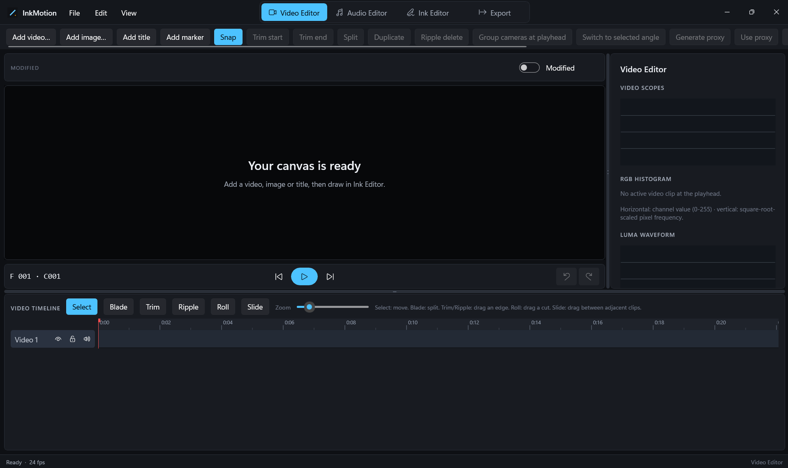
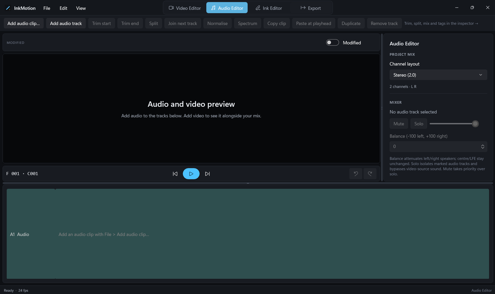
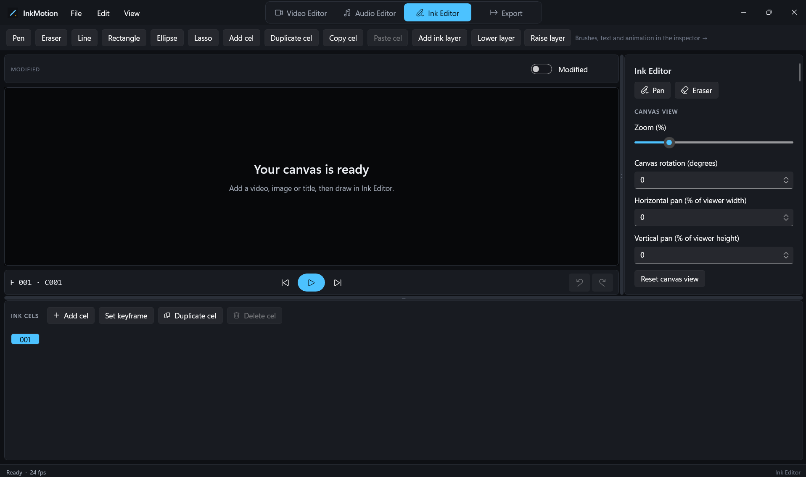
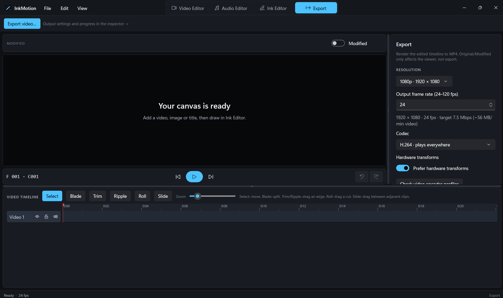

# InkMotion

A native Windows video, audio and animation editor built with C#, .NET 10, WinUI 3 and Win2D. Combine multitrack footage, sound, titles and hand-drawn animation in one project.

**InkMotion is actively developed and is not yet at full professional-editor feature parity.** See the [roadmap](plan.md#expanded-editor-delivery-sequence) for implementation details and remaining work.

## Platforms and project sharing

InkMotion is a Windows desktop application built with WinUI 3 and the Windows App SDK. It requires Windows 10 version 2004 (build 19041) or later. Release downloads are currently x64 and x86; the project also defines an ARM64 build target. There are no macOS, Linux, Android or iOS clients.

InkMotion has no in-app cloud synchronisation, live co-editing, presence, or merge/conflict resolution. A `.inkmotion` project is saved as a single file, and its media and LUTs remain externally linked. You can keep project files in a network or cloud-synchronised folder, but that is file storage rather than collaboration. Do not edit the same project in multiple InkMotion instances at once; close it elsewhere and let synchronisation finish before reopening it. Keep a backup and share the linked media separately.

## Get started

Download an x64 or x86 ZIP from [Releases](https://github.com/ShirazOps/InkMotion/releases), extract it and run `InkMotion.exe`. Release builds are self-contained; no separate .NET or Windows App SDK installation is needed. Builds are currently unsigned.

Switch between **Video Editor**, **Audio Editor**, **Ink Editor** and **Export** at the top of the window. Each workspace has its own toolbar and inspector, while one shared track layout keeps the default Video, Audio and Ink tracks visible in every workspace. Toolbar buttons that do not fit appear under **More options** (the ellipsis). Playback and undo/redo controls are shared. Use **View** to resize, hide or restore panels; layouts are remembered per workspace.

The red playhead tracks playback across the shared time ruler in every workspace. Click or drag the ruler to pause and choose a frame for **Split**, trims, range boundaries and other playhead-based edits. Audio clips and Ink cels align to the same ruler; cel widths reflect exposure duration. Audio clips include start offsets and tempo changes: click a waveform to seek, or drag it to select a range. Switching workspaces keeps the same position.

Open and save `.inkmotion` projects with **Ctrl+O** and **Ctrl+S**. Media and LUT files remain externally linked, so keep them available. The project media bin identifies missing sources and can search folders for unique filename matches before relinking.

Set **Video Editor > Project settings > Canvas width/height > Apply canvas dimensions** to save a custom project canvas and aspect ratio (1–8,192 whole pixels per side, up to 33.5 megapixels). The viewer fits that canvas, pointer positions remain relative to it, and Ink rulers use project pixels. Resizing retains normalised artwork positions rather than cropping or resampling existing drawings. Export resolution remains independent: a fixed canvas fits inside the output, with black unused space in video and transparent unused space in PNG/GIF drawing exports. Existing projects and new projects start with **automatic canvas (legacy)** framing; this setting can also restore the previous viewport/output behaviour. Canvas changes support undo/redo.

## Features

### Video and titles

- Multitrack video, image and title compositing, with source In/Out marks, insert/overwrite, snapping, markers, copy/paste, split, trim, ripple, roll, slide and cross-dissolves.
- **Compound track** converts the selected unlocked track into an editable, embedded timeline while preserving its placement, gaps, visibility, mute and audio-bus route. Select **Open compound** to edit its video, audio and ink, then **Return to parent** to apply those edits as one undoable change; return to the main timeline before saving or opening a project. Compounds support four nesting levels, independent copies when split or duplicated, source-bounded trims, opacity, fades and audio routing in preview and export. If the nested timeline grows, extend the compound's right edge where space permits. Tracks in multicamera groups or with linked audio, tracking or mattes referencing their clips must be unlinked first. Conversion groups one whole track at a time, not a simultaneous selection across tracks.
- In **Select** mode, drag a video, image or title clip's body to move it, or either highlighted edge to shorten or extend its duration. Video extensions use available source footage; still images and titles can be extended without changing playback speed. Track locks and neighbouring clips remain protected.
- Clip position, scale, rotation, crop, flips, opacity, fades, playback speed and reverse; keyframed transforms and supported effects.
- Animate playback with speed-ramp points set at the playhead in the clip inspector. Speeds interpolate linearly; changing a clip's duration keeps points relative to the clip. Preview and export follow the ramp. Embedded-audio export changes pitch with speed, while preview uses stepped 5% time-stretch. Ripple trim, roll, slide and joining work on ramped clips too: shortened edges keep the remaining ramp at the same timeline times, lengthened edges hold the edge speed, and joins combine both ramps when the speed meets without a jump at the cut; a speed jump is rejected rather than smoothed.
- **AI cut-out image…** opens a still image, lets you draw a box around the subject, and saves a transparent PNG using the imported MobileSAM models. Processing stays on-device; the original image is not changed.
- Exposure, contrast, white balance, saturation, gamma, RGB curves and 3D `.cube` LUTs; chroma key with spill suppression, blur, sharpening, vignette and animated masks.
- **HSL qualifier** (clip inspector → Colour): in an SDR project, select a wrapping hue range, saturation and HSL lightness bounds with feathering, then apply hue, saturation and lightness corrections only to that selection. Settings are static per clip, undoable and saved; preview, scopes and export share the same 33-point interpolated RGB table after primary grading/LUT. This is bounded working-RGB processing, not a scene-linear HDR secondary or spatial mask. Disable qualifiers and clear shot matches before switching to HDR.
- **Shot matching** (clip inspector → Colour): in an SDR project, select a video/image and put the playhead inside it, capture a reference, then select another shot and match. Local 128×72 graded samples drive RGB mean/standard-deviation matching after HSL and before spatial effects/compositing. Gains are limited to 0.25–4; flat channels use mean-only matching. The static correction is saved/undoable and shared by preview/export; repeated matching replaces it rather than compounding it. Reference statistics last only for this session. This is not semantic/AI matching; different framing can give poor results and highlight clipping is possible.
- **ACES display import** (Video panel → Local colour-managed still imports): select your local OCIO-enabled `oiiotool.exe` (OpenImageIO), explicitly choose ACEScg/AP1 or ACES2065-1/AP0, then import an RGB/RGBA `.exr` still into an SDR project. Uses the official built-in `ocio://cg-config-v2.2.0_aces-v1.3_ocio-v2.4` configuration, `sRGB - Display` / `ACES 1.0 - SDR Video` view, with alpha-aware processing. This is a genuine ACES 1.3 display transform baked into a 16-bit PNG, **not an ACES scene-linear grading timeline or ACES/HDR export**. InkMotion's existing SDR compositor uses 8-bit surfaces. No arbitrary EXR-space inference, sequence, deep or multilayer EXR support is promised. Your OpenImageIO build must include OCIO, the pinned built-in config, OpenEXR and PNG; missing tools/configs/codecs fail explicitly. Copies are limited to 64 Mi pixels and sources to 2 GiB, with cancellation and a five-minute timeout. Retain/share the editing copies under `%LocalAppData%\InkMotion\ImportedMedia`; the tool is not needed to reopen or export the saved project. Source interpretation is retained in the clip inspector. [OpenImageIO](https://github.com/AcademySoftwareFoundation/OpenImageIO/blob/main/LICENSE.md) and [OpenColorIO/configs](https://github.com/AcademySoftwareFoundation/OpenColorIO/blob/main/LICENSE) use permissive BSD-family licences; tools/configs are not redistributed or downloaded by InkMotion.
- **Camera-RAW still development** (same panel): select a local LibRaw `dcraw_emu.exe`, choose camera/automatic white balance and −2 to +2 EV development exposure, then select a still. Candidate extensions are `.dng`, `.cr2`, `.cr3`, `.nef`, `.arw`, `.raf`, `.rw2`, `.orf` and `.pef`; **the exact camera/compression must be supported by your LibRaw build**. AHD sensor demosaicing, highlight blending, explicit sRGB primaries/transfer and disabled automatic brightening produce a 16-bit TIFF editing copy; no embedded-preview extraction or rename-only RAW import. Missing tools, failed decodes and unreadable results are reported, not silently replaced. The same retained-media, SDR/8-bit-compositor, size and timeout limitations apply. Changing development settings means reimporting; this is not live RAW grading, ACES RAW development, RAW sequence playback or BRAW/R3D/ARRIRAW/CRM/motion-RAW support. LibRaw is [dual-licensed LGPL 2.1/CDDL 1.0](https://www.libraw.org/docs/); InkMotion invokes a user-supplied executable without linking or redistribution, and downloads no tool or model. Verify the licence of your chosen binary and optional codecs.

Colour-import integration regressions are opt-in: set `INKMOTION_TEST_OIIOTOOL` and `INKMOTION_TEST_LIBRAW` to local executables, then run `dotnet test` with `--filter "FullyQualifiedName~LocalColourImportTests|FullyQualifiedName~RawStillImportTests"`. These generate linear RGB/RGBA EXR and an uncompressed Bayer DNG without an embedded thumbnail; they verify actual converted pixels, alpha, exposure, unchanged originals, missing-tool/configuration errors and failed-decode cleanup. They do not certify every camera or compression variant. No tests download tools or media.
- Multicamera switching, local proxy generation, stabilisation and coarse rolling-shutter correction. RGB histogram, luma waveform and vectorscope for source grading.
- **Generate optical-flow proxy** uses the checked local FFmpeg's motion-compensated interpolation and libx264 to create a high-frame-rate, lossy SDR editing copy at up to four times the project frame rate (maximum 240 fps). The original remains unchanged and supplies embedded audio; preview and export both use the enabled proxy. Generating it can be slow and use substantial disk space. HDR sources are not supported, and interpolation can create artefacts around occlusions or scene changes. If the proxy is unavailable, the original is used instead.
- Double-click a title clip, title track header or title in the viewer to edit its text. In paused **Modified** Video preview, drag titles with mouse or touch, resize proportionally using corner handles and rotate with the round handle.
- Title font and size, with matching text/background colour pickers and independent opacity controls. Viewer edits respect track locks, support undo/redo and update transform keyframes on animated titles.
- Animate titles using **Set title motion keyframe**: mark the first pose, move the playhead and drag/rotate/resize the next pose. Subsequent pose edits automatically create or update keys; playback and export interpolate between them. Use **Previous/Next pose** or the title clip's blue motion markers to navigate.
- Right-click video/image/title headers for track properties or clips for their respective inspector. Audio lanes/headers and the Ink track header/lane also provide property menus.

**Original / Modified** compares the active video source at the playhead with the edited composition. Original is a source comparison, not a second unedited timeline.

### Audio

- Multitrack waveforms, sample-level source trimming, split/join, range copy/cut/silence, fades, peak normalisation, independent tempo/pitch and metadata editing.
- Generate character dialogue as WAV using an enabled Windows speech voice already installed on the device. Text, voice selection and synthesis stay local; the generated clip is added to a new audio track at the playhead.
- Volume, mute, solo, left/right balance and mono-source spatial panning. Project layouts from mono and stereo through surround, 7.1.4 and 12.1, with stereo monitoring.
- Non-destructive EQ and filters, noise gate, compression, sample-peak limiting, profile-based noise reduction, reverb and delay. Audio-file exports can optionally apply a linked-channel 4× windowed-sinc true-peak limiter. Delay and reverb tails continue beyond audio clip boundaries and are included in export duration.
- Embedded video-audio volume and balance automation, timeline curves and matching export processing.
- **Submix buses** (Audio inspector): route audio clips, and each video track's embedded audio, to named buses with their own gain, mute, solo and non-destructive effect chain; audio clips can also send post-fader audio to additional buses. Buses can be nested and are summed in the project layout before the master in both live preview and export; soloing a bus includes its descendant routes and silences unrelated sources.
- Selected-track and live preview master peak/RMS meters; complete-export-mix analysis with peak/RMS and integrated LUFS. Source spectrum and spectrogram analysis.
- Record a selected Windows audio input to WAV and place the take on the timeline. Audio/video clip linking and source relinking are also supported.
- **Sound effects** library (Audio toolbar): ten original effects – whoosh, swoosh down, pop, click, blip, riser, impact, chime, zap and sparkle – synthesised deterministically on this device and added at the playhead on a new audio track. No third-party recordings are bundled or downloaded. Files are cached in `%LOCALAPPDATA%\InkMotion\SoundEffects` and regenerated automatically if a project references a missing one.

### Beginner guide

- On first launch, choose **Start guide** for a click-through quick-start: add video or an image, open Ink Editor, create a layer, choose the pen, draw, preview and export.
- Pop-ups explain the highlighted control; steps advance only after the corresponding action succeeds. Cancelling an import/export picker or a failed export submission does not advance the guide. Export acceptance is not export completion: check **Export jobs** for the result.
- **Show me** reveals the current control. **Skip guide** or Esc exits; restart from **Help > Beginner quick-start guide**. The guide temporarily reveals editing panels without replacing saved layouts. Edits are real and undoable, and existing work is not reset.
- Welcome dismissal and completion are remembered on this PC, separately from project files.

### Ink and animation

- Mouse, touch and pressure-sensitive pen drawing, textured brushes, lines, rectangles, ellipses, solid shapes and enclosed-area bucket fill.
- Distinct saved brush behaviours: solid round, procedural grain, a fixed 45-degree calligraphy nib, soft radial airbrush stamps and separate dry-bristle strands. Choose presets or brush behaviour in the Ink inspector; each responds to pressure and shares preview, colour sampling and export. Airbrush density builds with path travel, not time held still; these use no third-party brush assets.
- **Smudge drawing tool** pulls earlier drawing pixels along a pressure-sensitive path on the active layer only. It is saved as a non-destructive modifier, replayed in stroke order by preview, onion skins, sampling and export. Original paths remain editable; undo or delete the modifier path to remove its effect. It does not sample other layers, cel text or timeline media, and a stationary tap makes no change. Merge-down rejects an upper layer containing smudge modifiers rather than silently changing their sampling source.
- **Blur drawing tool** locally softens earlier active-layer drawing beneath a pressure-sensitive path, without painting the brush colour or flattening paths. Saved modifier strokes replay in preview, onion skins, sampling and export; repeated strokes build the effect. Pen size controls coverage and Gaussian blur radius, capped at 250 output pixels. A tap blurs one spot. Like smudge, it excludes other layers, cel text and media, and upper layers containing blur modifiers cannot merge down without changing their sampling source.
- Partial/whole-stroke erasing and lasso selection, drawing transforms, independent layers with visibility/opacity/locks and Normal, Multiply, Screen, Add or Overlay blending, plus layer duplication, merging and flips. Blend modes apply against lower drawing layers and timeline video in preview and export; merge-down requires both layers to use Normal mode.
- **Alpha lock** in the Ink toolbar restricts new pen, brush, shape, smudge and blur marks to the active cel/layer's existing artwork alpha, without increasing or removing it. Alpha-locked bucket fill recolours the clicked connected artwork region rather than an empty enclosed area. Erasing and lasso/path transforms remain available; source paths stay editable. The layer toggle is saved and undoable, and each new stroke retains its restriction after the toggle is turned off, through cel copies, animation, rigging and export. Erasing underlying artwork also removes dependent locked painting there. Locking an empty cel cannot create the first marks. The restriction uses raw drawing alpha before layer effects, glow, clipping and blending; it does not lock cel text or media. Upper layers with alpha-locked strokes cannot merge down because that would change their alpha source.
- **Layer glow** adds a blurred halo in a chosen colour (taken from the brush) behind everything on a drawing layer, with adjustable radius and strength. It is a saved, non-destructive layer setting rendered identically in preview, colour sampling and export; strokes remain editable, duplicates keep the glow, and merge-down requires effects to be turned off first.
- **Layer pixel effect** renders a drawing layer as hard-edged square colour blocks (2–64 preview pixels, scaled with the output and anchored to the canvas origin) before glow and blending. It is a saved layer setting shared by preview, sampling and export; original strokes stay editable.
- **Layer clipping masks** ("Clip to layer below") show a drawing layer only where the nearest unclipped layer beneath it has drawn pixels, including that base layer's pixel and glow effects. Several clipped layers can share one base; hiding the base hides its clipped layers. Merge-down requires clipping to be released first.
- **Occlusion mattes** (foreground masking): mark a drawing layer as an "Occlusion matte" and paint over a foreground object, such as a hand or a passing person. The matte itself is never shown; wherever it is painted, every ink layer beneath it is hidden and the original video shows through, so the artwork appears to pass behind the object. Soft brushes and layer opacity give soft or partial occlusion, the matte can be animated cel by cel (rotoscoping) or attached to the object with Follow object, and it is tinted red while being edited in the Ink workspace. Ink layers above the matte, cel text overlays and timeline titles are not occluded. The matte can be painted by hand or generated automatically (see **Automatic occlusion matte** below). Mattes cannot be clipped, used as a clipping base or merged down.
- **Node compositing** (Layers panel → "Open node graph…"): an optional node graph that replaces the ink layer stack in both the live preview and exports while "Use node graph" is on. Drag from an output port to an input port to connect nodes; source nodes (Picture, Ink layer, Text, 3D scene and Particles) feed Merge (blend mode and opacity), Blur, Glow, Pixelate, Colour adjust (brightness, contrast, saturation, hue), Transform, Drop shadow, Sharpen, Vignette, Invert colours, Sepia and Mask (keep inside or outside a matte) nodes, which end in a single Output. Transforms scale and rotate around the canvas centre before applying their offset; shadows use the source alpha and have adjustable colour, opacity, blur and offsets. "Build from layer stack" creates an equivalent graph of the current layers to start from. While the graph is on, layer blend modes, clipping and occlusion-matte settings are ignored (layer opacity, visibility, tracking, glow and pixel effects still apply), loops are refused, and a node naming a deleted layer renders transparent. Graph edits are undoable and saved with the project; Follow object analyses the original picture without the graph. Colour sampling renders the full graph so that spatial effects are included, which can take longer on large canvases.
- **3D scene nodes** contain up to 32 cubes, spheres, planes or imported OBJ meshes with individual position, rotation, size, colour, visibility and spin. Use **Import OBJ mesh...** in the object inspector for polygon meshes and MTL diffuse colours/maps, or **Apply diffuse texture...** for a texture override. Geometry and decoded textures are embedded, so reopening/exporting needs no original OBJ assets. PNG/JPEG/BMP maps are resized to at most 512 pixels per side; alpha is ignored. OBJ supports positive/negative indices and planar convex polygons (triangulate concave faces first), at most 4,096 triangles per import and 32,768 per scene. Maps must be relative local files inside the OBJ folder; map options, transparent materials, smooth normals, glTF and other material channels are unsupported. Adjust the perspective camera and directional/ambient lighting, then connect the transparent scene to a Merge or other graph node. Shared depth, perspective-correct UVs and timeline spin match in preview, sampling and export; scene-only exports use the cel exposure duration. Opaque flat shading uses CPU rasterisation, so large scenes/output sizes can be slow.
- **Directional shadows** are optional per scene; set their strength and whether each object casts or receives them. A fixed-resolution shadow map is shared by preview and export, with softly filtered edges. Very large scenes can show coarse edges or bias artefacts, and shadow rendering adds CPU work.
- **Particle nodes** produce a transparent 2D stream of fading circles from the start of the timeline. Set the emitter position, rate, lifetime, direction, spread, speed, gravity, size, colour and random seed; combine the result with other nodes or use it as a matte. Optionally select a 3D scene, attract or repel particles from visible object centres, and bounce off projected object bounds with adjustable bounce. Interactions are 2D approximations using circular bounding proxies, not collisions with mesh surfaces, depth or occlusion; object rotation does not change the bounds. The selected scene need not be connected to the output, and removing it clears the selection. Their pattern is repeatable when seeking and is shared by preview, sampling and export. Particle-only exports use the cel exposure duration.
- Cel exposures, keyframes, eased in-between animation, configurable onion skinning, named cel groups, range editing and independent or linked drawing cycles. Ink-only animations can play without adding video or audio.
- **Character rig…** in the Ink toolbar builds an editable hierarchy of up to 64 bones over vector drawings. Select a bone, name/reparent it and enter its normalised rest endpoints; bind each artwork layer either to one bone for cut-out movement or to several bones for weighted bending. In weighted mode, select each influencing bone and apply its multiplier (zero removes it); point weights are calculated from distance to the rest segments and normalised. Long vector edges are subdivided before bending. Enter a timeline frame and local rotation, offsets, length multiplier and easing, then **Set pose key at frame**; select saved poses to inspect them. Apply buttons preview the draft; **Save rig** keeps one undoable change and **Cancel** discards it. **Show bones** is a preview-only guide. Extend cel exposures to cover the animation; bound layers hold their last non-empty drawing through empty cels. Turn animated rig preview off to edit original artwork, then re-enable it. Rigging runs before existing object tracking, clipping/mattes, effects and node compositing in preview and export, and persists with project files and compounds. This is vector linear-blend skinning with editable distance-weight influences, not imported raster/mesh rigs, inverse kinematics or per-vertex weight painting.
- **Lip-sync…** in the Ink toolbar analyses an imported audio clip on-device without downloading a model. It drafts five timed mouth states (Closed, Open, Wide, Round and Teeth) from loudness and high-frequency energy, respecting source trims, clip placement and tempo. This is an acoustic animation draft, **not phoneme recognition**: use clean dialogue, adjust the silence threshold and review/correct frames in **Timed cues**. **Mouth drawings** provides original starter vector mouths with adjustable bounds, or capture your own drawing from the active cel/layer for each state. **Edit selected mouth** loads a state into the current cel with lip-sync preview off; edit it normally, reopen the dialog and capture it. Keep the face on other layers, as lip-sync substitutes the whole mouth layer. Save/cancel is atomic and undoable; drawings, corrections and source timing persist, and rigs, tracking, masks/effects and export use the same mouths. Audio placement, trim, tempo, relinking or project-frame-rate changes suspend old cues and show an inspector warning; regenerate them. PNG/GIF drawing exports include the analysed interval without requiring one cel per mouth change. No audio is uploaded and no model weights are used.
- Per-layer **Follow object**: draw on a cel, select a textured object box in Modified preview, then track its position, rotation and size until the chosen end time. Other layers remain untracked. The tracker retries with a wider search when fast movement defeats its local search. After tracking loss, correct the box at the stop or a later visible frame and resume; motion between the last reliable pose and the correction is linearly interpolated. Tracking is saved and shared by preview/export.
- **Planar surface (corner pin in perspective)** option for Follow object: tracks a flat, textured surface such as a sign, screen or wall as it turns in perspective, and pins the corners of the selected box to it so drawings and text are warped onto the surface. Rigid mode remains the default for objects that only move, rotate or scale. The mode is chosen before tracking and is fixed until tracking is cleared.
- **Deformable mesh (bending surface)** tracking mode for Follow object: follows a smoothly bending, textured surface such as fabric, paper or a flag with a 4 × 4 mesh over the selected box, and warps the attached drawing, cel text or title piecewise with the mesh so it bends with the surface; artwork outside the box follows the mesh's overall motion. It is local feature tracking of a hand-selected box, not semantic AI, body or limb tracking: folds, occlusion, fast motion and plain, untextured areas stop it, and you can correct the box and resume.
- **Articulated limb** tracking modes for Follow object, for artwork attached to a bending arm, leg or other jointed part. Drag a line along the segment from joint to joint (for example shoulder to elbow); the drawing then follows that segment's position, direction and length, so it turns and stretches as the limb bends. **Two-point** mode tracks textured patches at both ends of the line and works on every build. **AI pose (Windows ML)** mode estimates the body pose on each frame with an RTMPose model and follows the matching body segment, so it copes better with clothing folds and brief occlusion. AI pose tracking follows one person: the one nearest the drawn line.
- **Automatic occlusion matte**: on an occlusion-matte layer, draw a box around a foreground object at the playhead and choose **Automatic matte from box**. A MobileSAM segmentation model outlines the object on each frame until the chosen end time, and follows it as it moves. The generated matte is combined with any painted matte, saved with the project, used by preview and export, and can be cleared without affecting the painting.
- **On-device AI models** (Ink workspace → AI MODELS): AI pose tracking, automatic mattes and image cut-outs run entirely on this device with Windows ML, which uses a suitable local GPU or NPU execution provider when Windows offers one and otherwise runs on the CPU. No frames or images leave the computer. The models are not bundled. Import an `.onnx` file you have exported yourself (see [`build/models`](build/models/README.md)); InkMotion checks it, shows its SHA-256 and stores it under `%LOCALAPPDATA%\InkMotion\Models`. Download is offered only for models with a published, hash-pinned source, and only after you agree in a confirmation dialogue; no model is downloaded automatically. Windows ML is available on x64 and ARM64 only. On x86 builds the AI options are disabled with an explanation, while the two-point limb, rigid, planar and mesh modes and painted mattes remain available.
- Subtitle tracks support editable timeline cues, SubRip (`.srt`) import/export, overlapping captions on separate lanes and a default lower-screen caption style. Imported cue times align to the project frame rate.
- **Generate subtitles from speech** (File menu) transcribes the audible timeline mix – honouring mute, solo and buses – on this device, then adds editable cues to a new subtitle track. Use the Windows desktop recogniser with a confidence threshold and pause-aware punctuation, or import the multilingual Whisper tiny model for local recognition and punctuation. Optionally import local speaker diarisation models to label speaker turns. No audio is uploaded and InkMotion never downloads speech models; see [`build/models`](build/models/README.md) for model sources, licences and the files to import. Review the generated wording, timing and speaker labels.
- Cel text overlays with character-range styling; drawing-only or full-preview colour sampling.
- Canvas zoom, pan, rotation, grids and output-pixel rulers. Optional vertical-centre mirror drawing and grid snapping preserve the existing freehand and shape behaviour when off. Import footage or images as references beneath the artwork.

### Export

- H.264 or HEVC MP4 at 720p, 1080p, 1440p, 4K UHD or custom even dimensions up to 8,192 pixels per side and 33.5 megapixels total, with independent output frame rates from 24-120 fps. Custom export dimensions do not change the project canvas.
- Transparent PNG sequences of visible drawing layers and cel text, saved as numbered frames in a new folder. Timeline footage and titles are excluded.
- Animated looping GIFs of visible drawing layers and cel text, with transparent backgrounds. GIF transparency is binary, and timing uses 10 ms increments, so export supports 24–50 fps; timeline footage and titles are excluded.
- Software encoding or a hardware preference with reported software fallback. Preview and export share the composition and effect pipeline.
- Separate PCM/float WAV, MP3 and AAC/M4A mixes. Multichannel WAV supports the project layout; MP4 carries up to 5.1 AAC, with a companion full-layout WAV when needed.
- Optional local FFmpeg adds 16/24-bit FLAC mixes up to 384 kHz and 8 channels, 48 kHz mono/stereo Opus, and Matroska video with AAC, PCM, FLAC or Opus audio.
- Optional FFmpeg also exports WMA audio (`.wma`, wmav2, 44.1/48 kHz stereo/mono), Windows Media Video (`.wmv`/ASF, wmv2 with WMA audio), and AV1 in MP4 or Matroska. WMV uses software encoding; AV1 uses libaom-av1 software or an explicitly selected NVENC/QSV/AMF AV1 encoder when supported. Use **Check video encoder profiles** to test the selected codec/device/profile before a long job; no codec or hardware fallback is hidden.
- FFmpeg video offers explicit CPU, NVIDIA NVENC, Intel Quick Sync and AMD AMF encoders with no automatic hardware-to-software substitution. Selected-profile probes report unsupported devices/codecs.
- **HDR colour workflow** (Canvas → Project colour): projects can use HDR10 (PQ) or HLG with explicit reference-white and peak-brightness settings. On an HDR display, preview uses a scRGB half-float swap chain; on SDR displays it falls back to the existing tone-mapped preview. HDR projects composite in 16-bit float, decode HDR source video through optional FFmpeg (converting to the project's working space), and export 10-bit Rec.2020 HEVC or AV1 through FFmpeg with colour tags; PQ exports through libx265 also carry HDR10 mastering-display and MaxCLL metadata. SDR projects are unchanged.
- Persistent background export jobs with progress, cancellation and retries. Jobs use saved project snapshots and continue independently of the editor.

For optional formats, choose a trusted local `ffmpeg.exe` under **Export > Optional FFmpeg** and check its capabilities. InkMotion does not download, bundle or redistribute FFmpeg; available encoders and licensing depend on your build. Existing Windows exports need no FFmpeg. Saved jobs retain the executable path.

**WMA, WMV and AV1 import:** normal audio/video import uses installed Windows decoders. If those codecs are missing, check the selected FFmpeg executable and enable **Use FFmpeg compatibility imports for WMA, WMV and AV1** on Export before importing or relinking. This applies to audio import, timeline video import, source monitor and media relinking. AV1 inside MP4/MOV/M4V/Matroska/WebM is detected with `ffprobe.exe` beside FFmpeg; non-AV1 files in those containers remain unchanged. Raw `.av1` streams are also accepted using FFmpeg's source timing.

Compatibility imports decode WMA to float WAV and transcode WMV/AV1 to high-quality H.264/AAC editing copies (first video/audio streams, odd dimensions padded to even pixels). Video conversion is lossy, not a bit-exact AV1/WMV editing path. Originals are not modified. Copies live in `%LOCALAPPDATA%\InkMotion\ImportedMedia`, are reused until the source size/timestamp changes, and are linked in the saved project for preview, waveforms, effects and export. They are **not temporary proxies**: keep or move/relink these files with the project, and only remove them when no project needs them. Reopening a converted project needs no FFmpeg unless importing/converting more media.

### Screen recording

Use **File > Screen recorder** to record one or more displays, or add regions using global physical-pixel coordinates (including negative monitor positions). Selected areas retain their relative placement on one canvas; gaps are black. Choose a 1920/3840-pixel longest-side limit, 15/24/30 fps, and whether to include the pointer.

**Draw box** or **Draw freeform** selects directly over the live desktop with a mouse or pen, including across monitors. Outside the selection is fogged while drawing. Release to place the outline: the fog clears immediately and applications remain usable inside and outside it, so you can rearrange windows before recording. Drag the box edges/corners to resize; freeform selections have a resizable bounding box that scales their closed shape. Left/Top/Width/Height update live. Repeat to add more areas; outlines disappear before recording begins and are not included in the video. Before placing, **Reset entire screen** (R) selects the full display and **Cancel** (Esc) discards the drawing. The recording is cropped to the selected areas' bounding box, with pixels outside freeform shapes and gaps between areas black. **Reset to entire screen** in the recorder replaces all regions with the selected full display.

15 fps capture opens on a 30 fps editing timeline without changing its duration; 24/30 fps captures use matching project rates.

System output audio, microphone and webcam are explicitly selected and off by default. Each becomes a separate editable source; the webcam can appear picture-in-picture in the resulting project. Use headphones to avoid microphone echo. Windows camera/microphone privacy settings still apply.

Under **Recording workflow**, choose a **0, 3, 5 or 10 second countdown**. **Cancel countdown** cancels before capture starts. **Stop after** sets a timed recording limit in minutes (fractions allowed down to one second, maximum 1,440 minutes); **0** keeps manual stopping. The limit excludes the countdown and starts with capture, including optional-device startup. Timed stops finalise and save like manual stops, with remaining time shown during recording.

**Minimise this recorder when capture starts** gets the recorder out of the way after the countdown; it does not minimise the main editor or exclude any InkMotion windows from capture. Arrange the editor yourself if it should not appear. Return through the taskbar or **File > Screen recorder** to stop manually. Turn off **Open the saved recording in the editor** to keep completed takes in the library without replacing the editor's current project, ready to record another take.

Enable **Ctrl+Shift+F10 stops and saves from any application** before starting to stop without returning to InkMotion. The shortcut works while the recorder is minimised and cancels the countdown if capture has not begun. It is reserved only during the countdown/take and released when stopping or finalising. If Windows cannot reserve the combination (for example, another app owns it), InkMotion reports the conflict before capture starts; disable the option or free the combination. The shortcut cannot start a recording and is not a keyboard logger.

**Stop and save** creates a durable `.inkmotion` project before optionally opening it. Screen segments, separate audio/webcam files and recovery metadata remain under `%LOCALAPPDATA%\InkMotion\ScreenRecordings`. The recorder's library shows storage use and opens saved/interrupted takes; removal requires explicit confirmation and is blocked while the editor uses those sources. No automatic cleanup removes recordings.

Capture is best-effort desktop SDR capture, not protected-content, secure-desktop or exclusive-fullscreen capture. Slow frames repeat to preserve elapsed time; disconnected/rearranged displays stop the take. Five-second screen checkpoints survive crashes, but the unfinished MP4/device files may need external recovery. Review sync on your devices; separate tracks allow timing correction. Do not change device formats or displays mid-take.

## Privacy

Media is processed locally, without application analytics or automatic uploads. See the [privacy policy](PRIVACY.md) for microphone use, local working files, background exports and optional tools.

## Current limits

Windows codecs and hardware determine playback and encoding availability; HEVC needs the HEVC Video Extensions. Encoder probes are local checks, not device certification. Reverse video preview mutes embedded audio; export can reverse it or leave it muted.

Stabilisation and noise reduction need review on real material. Delay and reverb tails continue beyond audio clips during export. The per-track and bus effects limiter is sample-peak; audio-file exports optionally apply a linked-channel 4× windowed-sinc true-peak limiter with seven-frame look-ahead and a 100 ms release.

Live input monitoring is explicitly started/stopped in Audio Editor, with a selected input, output, 44.1/48 kHz rate and -60 to 0 dB listening level (initially -12 dB). **Use headphones to prevent acoustic feedback.** This local PCM path does not save, transmit, enter project routing or appear in exports. Monitoring and audio/screen recording are mutually exclusive. Device additions/removals stop monitoring and require refresh and an explicit restart; capture/output errors and bounded-buffer overruns are reported. Closing the window releases both devices. Latency depends on Windows/driver buffering; this is not ASIO or hardware direct monitoring.

Speech-generated subtitles come from the offline Windows dictation recogniser, which is far less accurate than modern speech models and does not identify speakers or add punctuation reliably; music and noise reduce accuracy further, so review every cue. Audio stem export creates a ZIP containing a direct-master WAV and one solo WAV per bus, with all stems aligned to the full mix duration. Parent-bus stems include their child buses, so nested stems are not additive. Bus mute and audio-track solo states are honoured; bus solo states are ignored so every bus is exported. Stems use the selected WAV sample rate and PCM depth, and cancellation or failure removes the incomplete archive. Bus effects exclude profile-based noise reduction, and video audio played through the Windows media fallback honours bus mute/solo but not bus gain or effects. FFmpeg video retries reuse completed five-second segments when linked media/settings are unchanged; the current segment and audio/mux stages restart. Windows and audio-only exports restart from the beginning. Failed/cancelled FFmpeg video jobs retain checkpoints locally until a successful retry.

HDR preview needs an HDR-mode display and a half-float-capable graphics device; otherwise it falls back to SDR tone mapping. HDR export needs FFmpeg with HEVC or AV1; H.264, WMV, Windows (Media Foundation) export, GIF and PNG sequences remain SDR or are refused for HDR projects. Rolling-shutter correction is not applied to HDR sources, and object tracking analyses an SDR rendition. PQ HDR projects can optionally include a locally generated HDR10+ JSON sidecar when using FFmpeg software HEVC with x265. The sidecar must contain exactly one consecutive metadata entry for every final output frame; InkMotion validates frame alignment and encodes the sequence as one segment, but does not generate or download metadata. Dolby Vision remains unsupported because InkMotion has no approved licensed encoding stack.

Project files automatically migrate older formats. Export snapshots, linked paths, recordings and proxies are stored locally; keep source files unchanged while jobs run.

Object following is local feature tracking for textured objects, not semantic AI. Rigid and planar modes assume an approximately rigid object; planar mode also assumes the tracked area is flat, so curved, bending or untextured surfaces drift or stop tracking. Deformable mode tolerates smooth bending only, not folding, self-occlusion or articulated limbs. Review the result for drift. Empty cels hold the drawing at the reference time; existing cel animation still plays, so changing cel timing can change that reference drawing. Cel-global text is not attached. Disable following to edit original strokes; new/duplicated layers do not inherit motion, and tracked layers must have tracking cleared before merging. Source-clip property changes require clearing and recalculating tracking; replacing a source file in place also requires recalculation.

## Build from source

Requires Windows 11, the .NET 10 SDK and Windows SDK 10.0.19041 or newer. Supported build targets are x64 and x86.

```powershell
dotnet restore InkMotion.sln -p:Platform=x64
dotnet build InkMotion.sln -c Release -p:Platform=x64 --no-restore
dotnet test InkMotion.sln -c Release -p:Platform=x64 --no-build --no-restore
& .\src\InkMotion\bin\x64\Release\net10.0-windows10.0.19041.0\InkMotion.exe
```

For x86, use `Platform=x86` and the corresponding output directory. [Windows CI](.github/workflows/windows-ci.yml) builds and tests both architectures and publishes portable releases from `main`. [Store packaging](.github/workflows/windows-store-package.yml) uses repository secrets for the Microsoft Partner Centre identity; never commit credentials or signing certificates.

### Microsoft Store updates

Each successful `main` release includes a verified x86/x64 `.msixupload` when the Store identity secrets are configured, plus a copy-ready `InkMotion-build-<build>-whats-new-<language>.txt` file for each language in [`build/store-release-notes.json`](build/store-release-notes.json). Download the files from [GitHub Releases](https://github.com/ShirazOps/InkMotion/releases). In [Microsoft Partner Centre](https://partner.microsoft.com/dashboard), create an update, upload the `.msixupload` under **Packages**, and copy the matching text into each listing's **What's new** field. Review the inherited listing, availability and publication settings, then submit for certification. Release notes and the Actions summary include these steps.

Submission and publication are manual; no Microsoft Entra tenant or Store submission API credentials are required. Existing Store package identity values remain exclusively in **GitHub Actions secrets**, not repository variables or files. The workflow does not log into Microsoft Partner Centre, upload to the Store or change account permissions.

Update the release-notes JSON in the feature PR before merging: keys are lowercase Store listing language codes and values are non-blank plain text of up to 1500 characters. The workflow validates these values, requires English (`en-us`) notes, and exports one UTF-8 text attachment per language. English notes also appear in GitHub release notes. Copy notes into any relevant platform-specific listing overrides during manual review. Do not put credentials or internal information in this publicly committed text.

Package versions use the CI build number (`1.0.<build>.0` with the current manifest) and must exceed every published package. If you change the major/minor version in Microsoft Partner Centre, update the manifest base version accordingly. Wait for an existing submission to finish before uploading the desired newer build, and monitor certification in Microsoft Partner Centre. Tag/manual packaging runs continue to produce package artefacts; successful `main` CI runs attach packages and release-note text files to GitHub releases.

<details>
<summary>Workspace screenshots (empty-project layout examples)</summary>






</details>
